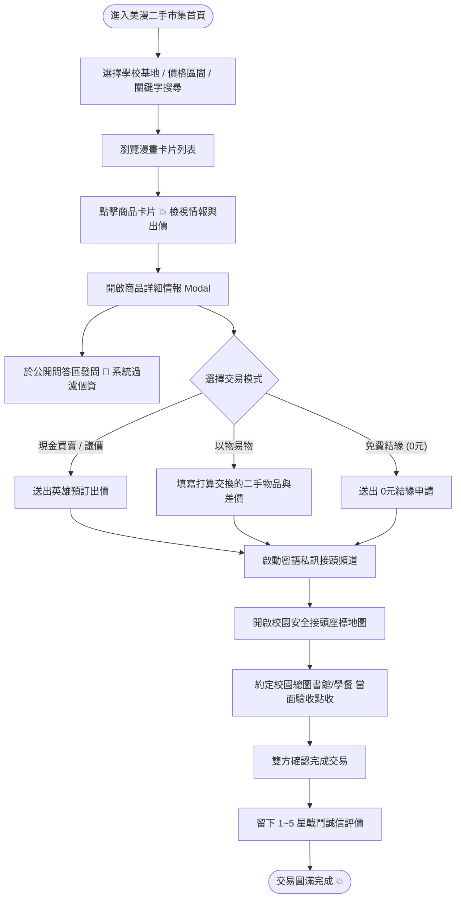

# 全國大學生二手物品交換與買賣平台 - UI/UX 設計規範書 (美式波普美漫版)

> **專案版本**：v2.0 (經典美式波普美漫旗艦版・Vibe Coding 課程專題)  
> **核心設計語言**：American Comic Pop-Art (美式漫畫波普風)  
> **核心代表頁面**：`style2-american-comic.html`  
> **主要展示入口**：`index.html`  

---

## 一、網站資訊架構 (Information Architecture)

```
[首頁市集 / 英雄大廳]
├── 頂部宣告跑馬燈 (Comic Ticker Banner)
│   └── BOOM! 全國大專二手英雄交易局・.edu.tw 認證保護・安全同校面交
├── 導覽中樞 (Global Navbar)
│   ├── 品牌 Logo [UNITRADE COMICS! ⚡]
│   ├── 學校基地切換器 (台大、陽明交大、清大、成大、政大)
│   ├── 快速全域搜尋欄 (輸入書名、型號、規格)
│   ├── 📸 AI 拍照速估 (自動辨識上架)
│   ├── 🤖 AI 英雄特派員 (智慧導購問答)
│   ├── 💥 快速出擊刊登 (物品上架表單)
│   ├── ⭐ 收藏清單抽屜 (Drawer + 本地暫存 localStorage)
│   └── 🦸 特工個人基地 (身分驗證、刊登管理、狀態追蹤、通知)
├── 英雄 Hero 刊頭中樞 (Halftone Blue Banner)
│   ├── 震撼漫畫標題 (課本不留白・二手大反擊！)
│   ├── 核心價值倡議 (以物易物・同校面對面驗收)
│   └── 快捷分類 Chips (必修教科書、3C神裝、以物換物、0元結緣、AI估價)
├── 進階過濾控制列 (Filter & Controls Strip)
│   ├── 戰鬥型態切換 (全部 | 💰現金收購 | 🔄以物換物 | 🎁0元免費結緣)
│   ├── 預算範圍篩選器 (最低價/最高價輸入 + 500元、2000元快捷按鈕)
│   ├── 認證特工篩選 (僅顯示 .edu.tw 認證賣家)
│   └── 排序選單 (最新上架優先 | 價格由低至高 | 價格由高至低)
├── 漫畫主網格區 (Main Comic Grid)
│   ├── 商品英雄卡片 (多視角圖、新舊物況、所屬學校、價格/換物標籤、收藏星號)
│   └── 空白狀態 (OOPS! NO HERO LOOT! 漫畫插圖引導重設)
├── 安全防衛指引 (Halftone Red Banner)
│   ├── 校園安全面交防衛指引
│   └── 📍 檢視全台校園安全接頭座標 (地圖 Modal)
├── 手機專屬底部導覽列 (Mobile Bottom Nav - <640px)
│   └── 市集 (⚡) | AI 顧問 (🤖) | 刊登 (＋) | 收藏 (⭐) | 我的 (🦸)
└── 頁尾資訊 (Footer)
    └── 專題規格說明與文件超連結
```

---

## 二、使用者操作流程圖 (User Flow)



---

## 三、美式波普美漫設計系統規範 (Design System Tokens)

### 1. 色彩規範 (Color Palette)

| Token 名稱 | 色碼 / 樣式 | 視覺角色與意涵 |
| :--- | :--- | :--- |
| `--comic-yellow` | `#FACC15` / `#FEF08A` | 戰隊電光黃：背景主色、重點按鈕、聚焦強調。 |
| `--comic-red` | `#DC2626` / `#EF4444` | 美漫鮮紅：強烈視覺衝擊、BOOM! 標籤、CTA 主行動。 |
| `--comic-blue` | `#2563EB` / `#1D4ED8` | 隊長英雄藍：Hero 刊頭底色、AI 助理、信賴元素。 |
| `--comic-black` | `#000000` | 粗獷墨線（Inking）：外框（3.5px solid）、純黑硬投影。 |
| `--comic-green` | `#16A34A` / `#22C55E` | 結緣綠：0 元贈送標籤、.edu.tw 認證學生徽章。 |
| `--halftone-bg` | `radial-gradient(#F59E0B 1.8px, transparent 1.8px)` | Ben-Day Halftone 美漫網點紙張紋理。 |

---

### 2. 字體排印規範 (Typography)

* **美漫震撼英文字體**：`'Bangers', cursive`
  - 用途：大標題、LOGO、價格數字、狀聲詞標籤（BOOM!、POW!、ZAP!）。
  - 特色：帶有粗黑投影 `drop-shadow-[3px_3px_0px_#000000]`，視覺張力極強。
* **中文主內文字體**：`'Noto Sans TC', sans-serif`
  - 字重：`font-bold (700)`、`font-black (900)`
  - 用途：商品品名、物況描述、操作按鈕文字，確保高清晰度與易讀性。

---

### 3. 邊框、陰影與美漫特效 (Borders & Shadows)

* **粗黑墨線邊框**：
  - 主卡片與容器：`border: 3.5px solid #000000;`
  - 小型徽章與輸入框：`border: 2.5px solid #000000;`
* **純黑實體硬投影 (Hard Drop Shadow)**：
  - 標準按鈕與小卡片：`box-shadow: 5px 5px 0px #000000;`
  - 大型刊頭與 Modal 彈窗：`box-shadow: 10px 10px 0px #000000;`
* **尖尾對話框氣泡 (Speech Bubble)**：
  - 聊天訊息使用偽元素 `::after` 與 `::before` 繪製經典漫畫尖角引導三角形。
* **狀聲詞貼紙 (Burst Badges)**：
  - 多角鋸齒狀造型，配合 `-2deg` ~ `2deg` 微旋轉，創造動態打擊感。

---

## 四、元件與介面狀態設計規範 (Component States)

1. **按鈕狀態 (Button States)**：
   - **Default**：鮮黃或鮮紅色底、3.5px 黑框、`5px 5px 0px #000` 投影。
   - **Hover**：位置向上微移 `translate(-3px, -3px)`，投影放大至 `8px 8px 0px #000`。
   - **Active (Pressed)**：向下壓扁 `translate(2px, 2px)`，投影縮小至 `2px 2px 0px #000`，提供即時打擊反饋。
2. **空白狀態 (Empty State)**：
   - 漫畫 OOPS! 巨大文字標題，提示使用者放寬學校或價格預算，提供一鍵「重設所有雷達條件」按鈕。
3. **表單與輸入狀態 (Inputs)**：
   - 輸入框獲得焦點（Focus）時，背景自動變白，確保輸入對比度高於 7:1。
4. **手機端無障礙與響應式規範 (Mobile Responsive)**：
   - 手機螢幕（< 640px）時自動呼叫底部固定導覽列（Mobile Bottom Nav），按鈕觸控區域大於 48x48px，符合 WCAG AA 標準。
